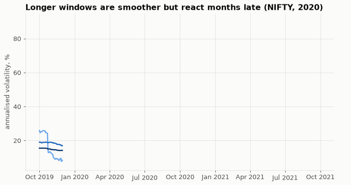

# Returns & Volatility Dashboard

[](https://github.com/Dhirajdas18/returns-volatility-dashboard/actions/workflows/ci.yml)
[](https://dhirajdas18.github.io/returns-volatility-dashboard/)

Volatility measurement and forecasting for NSE large caps (RELIANCE, HDFCBANK, INFY, TCS, ITC) and the
NIFTY 50, on daily data from 2013. Every forecast is scored out of sample.

**Live dashboard: [dhirajdas18.github.io/returns-volatility-dashboard](https://dhirajdas18.github.io/returns-volatility-dashboard/)**,
a static interactive site rebuilt every week from fresh data by GitHub Actions.

## Features

- [x] Rolling volatility across windows, with the window-length trade-off measured
- [ ] EWMA, GARCH(1,1) and high/low range estimators
- [ ] Out-of-sample volatility forecast comparison (RMSE, QLIKE)
- [ ] Implied (India VIX) vs realised volatility and the variance risk premium
- [ ] Risk-adjusted returns: Sharpe, Sortino, Calmar, rolling Sharpe, monthly heatmap
- [ ] Rolling beta and correlation, volatility regimes
- [ ] Volatility targeting

## Findings

### 1. Window length trades speed for noise, and every window has a ghost

<table><tr>
<td><a href="docs/img/rolling_windows.png"><picture><source media="(prefers-reduced-motion: reduce)" srcset="docs/img/rolling_windows.png"></picture></a></td>
<td><a href="docs/img/rolling_ghost.png"><picture><source media="(prefers-reduced-motion: reduce)" srcset="docs/img/rolling_ghost.png"></picture></a></td>
</tr></table>

- In the 2020 crash, NIFTY's 20-day volatility peaked on 9 Apr 2020 at 90%. The 60-day window peaked
  seven weeks later (1 Jun, 59%). The 252-day window peaked on 3 Mar 2021 (32%), when markets had been
  calm for months.
- The 20-day estimate is about 15× noisier: its median daily change is 0.25 volatility points against
  0.02 for the 252-day window.
- **Ghost effect:** on 24 Apr 2020 the 20-day volatility fell from 75% to 54% even though NIFTY dropped
  1.7% that day. The cause was not that day's move: the 23 Mar −14% day had simply left the window.
  Equal-weight windows forget a shock all at once. Weighting recent days more heavily fixes this (next
  section).

## Quick start

```bash
uv sync
uv run python scripts/fetch_data.py   # Yahoo Finance -> data/prices.parquet
uv run rv-report rolling              # charts -> out/, key numbers printed
uv run python scripts/build_site.py   # dashboard -> site/index.html
uv run pytest
```

## Design

- `src/rv/data.py`: Yahoo OHLC + adjusted closes in one (field, symbol) table; flags suspicious
  adjusted-price drops.
- `src/rv/vol.py`: volatility estimators, all annualised.
- `src/rv/site.py`: the dashboard, one static Plotly page; no server, no committed data.
- `src/rv/reports.py`: README findings, reproducible with `rv-report <topic>`.
- Charts: one validated palette; README charts are animated GIFs with a static fallback for
  reduced-motion users.

MIT licence.
