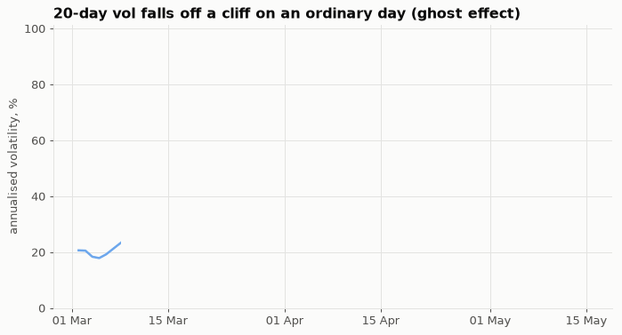
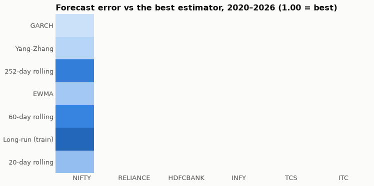
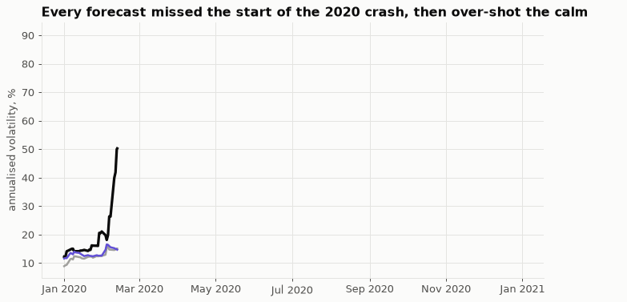
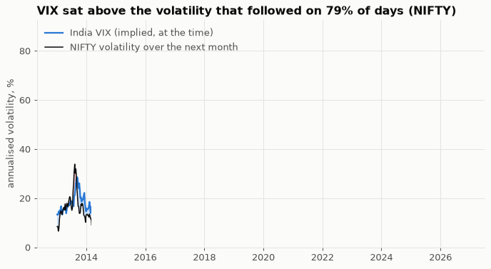
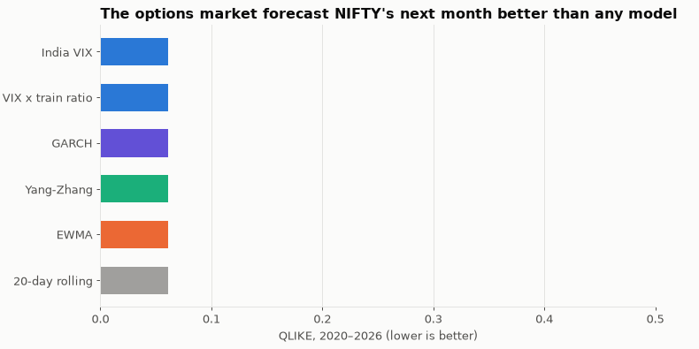
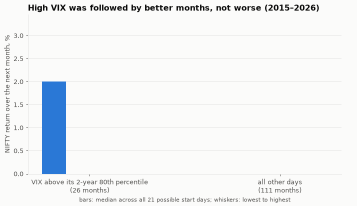
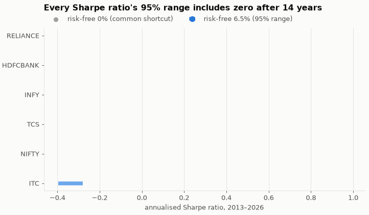
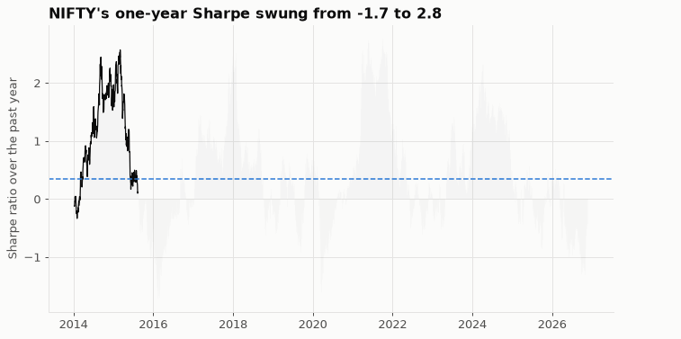
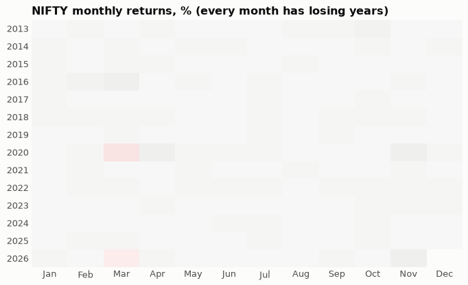

# Returns & Volatility Dashboard

[](https://github.com/Dhirajdas18/returns-volatility-dashboard/actions/workflows/ci.yml)
[](https://dhirajdas18.github.io/returns-volatility-dashboard/)

Volatility measurement and forecasting for NSE large caps (RELIANCE, HDFCBANK, INFY, TCS, ITC) and the
NIFTY 50, on daily data from 2013. Every forecast is scored out of sample.

**Live dashboard: [dhirajdas18.github.io/returns-volatility-dashboard](https://dhirajdas18.github.io/returns-volatility-dashboard/)**,
a static interactive site rebuilt every week from fresh data by GitHub Actions.

## Features

- [x] Rolling volatility across windows, with the window-length trade-off measured
- [x] EWMA, GARCH(1,1) and range estimators (Parkinson, Garman-Klass, Yang-Zhang)
- [x] Out-of-sample volatility forecast comparison (QLIKE, RMSE)
- [x] Implied (India VIX) vs realised volatility, the volatility risk premium, VIX as a forecast
- [x] Risk-adjusted returns: Sharpe with its uncertainty, Sortino, Calmar, rolling Sharpe, monthly heatmap
- [ ] Rolling beta and correlation, volatility regimes
- [ ] Volatility targeting

## Findings

### 1. Window length trades speed for noise, and every window has a ghost

<table><tr>
<td><a href="docs/img/rolling_windows.png"><picture><source media="(prefers-reduced-motion: reduce)" srcset="docs/img/rolling_windows.png"></picture></a></td>
<td><a href="docs/img/rolling_ghost.png"><picture><source media="(prefers-reduced-motion: reduce)" srcset="docs/img/rolling_ghost.png"></picture></a></td>
</tr></table>

- In the 2020 crash, NIFTY's 20-day volatility peaked on 9 Apr 2020 at 90%. The 60-day window peaked
  seven weeks later (1 Jun, 59%). The 252-day window peaked on 3 Mar 2021 (32%), when markets had been
  calm for months.
- The 20-day estimate is about 15× noisier: its median daily change is 0.25 volatility points against
  0.02 for the 252-day window.
- **Ghost effect:** on 24 Apr 2020 the 20-day volatility fell from 75% to 54% even though NIFTY dropped
  1.7% that day. The cause was not that day's move: the 23 Mar −14% day had simply left the window.
  Equal-weight windows forget a shock all at once. Weighting recent days more heavily fixes this (next
  section).

### 2. EWMA and GARCH fix the ghost; high/low estimators need the overnight gap

<table><tr>
<td><a href="docs/img/estimators_2020.png"><picture><source media="(prefers-reduced-motion: reduce)" srcset="docs/img/estimators_2020.png"></picture></a></td>
<td><a href="docs/img/garch_forecast.png"><picture><source media="(prefers-reduced-motion: reduce)" srcset="docs/img/garch_forecast.png"></picture></a></td>
</tr></table>

- **EWMA** (each day's weight shrinks 6% a day) peaked on 25 Mar 2020, two weeks before the 20-day
  window. Its largest one-day fall was 2.3 volatility points, against 21.1 for the 20-day window. Old
  shocks fade out; they don't fall off an edge.
- **GARCH(1,1)** adds a pull back to a long-run level. For NIFTY: persistence 0.977, long-run
  volatility 16%, and half of any shock gone in about 30 trading days. On 23 Mar 2020 it forecast 89%
  for the next day, 72% a month out, 46% three months out and 26% after six months. Shocks fade much
  faster in INFY and ITC (half-life about 4–5 days) than in NIFTY or HDFCBANK (25–30 days).
- Parameters here are fitted on the whole history, so this section describes behaviour; forecasting
  skill is tested out of sample in section 3.

<a href="docs/img/range_vs_close.png"><picture><source media="(prefers-reduced-motion: reduce)" srcset="docs/img/range_vs_close.png"></picture></a>

- High/low **range estimators** (Parkinson, Garman-Klass) use the whole day's path, so on simulated data
  they are much less noisy than close-to-close for the same window. On NSE they read 6–22% too low:
  21–37% of daily variance happens overnight, between one close and the next open, and they never see it.
  NIFTY loses the most (37% overnight, 12.6% vs 16.2%), because global news lands while India sleeps.
- **Yang-Zhang** adds the overnight gap back and lands within about ±10% of close-to-close on every
  series, keeping most of the noise reduction.

### 3. Out of sample, GARCH and Yang-Zhang forecast best; a 20-day window is among the worst

<table><tr>
<td><a href="docs/img/forecast_scoreboard.png"><picture><source media="(prefers-reduced-motion: reduce)" srcset="docs/img/forecast_scoreboard.png"></picture></a></td>
<td><a href="docs/img/forecast_2020.png"><picture><source media="(prefers-reduced-motion: reduce)" srcset="docs/img/forecast_2020.png"></picture></a></td>
</tr></table>

Every day each estimator forecasts the next 21 trading days' volatility. GARCH is fitted on 2013–2019
only and then run forward without refitting; scoring covers 2020–2026 (about 80 independent months per
symbol). The score is QLIKE, the standard loss for volatility forecasts, which punishes under-forecasting
risk more than over-forecasting.

- **GARCH ranks first on average and Yang-Zhang second.** GARCH beat EWMA in 28 of 42 symbol-years and the
  20-day window in 32 of 42, but tied Yang-Zhang (21 of 42), so there is no clear winner between those two.
- **The 20-day window ranks last** on average (up to 2.2× the best error, for ITC): it reacts fast but its
  noise costs more than its speed gains. A slow 252-day window does surprisingly well for stocks whose
  shocks fade within days (INFY, ITC), because next month usually looks like the long run.
- **At a 5-day horizon the field tightens:** Yang-Zhang, GARCH and EWMA all land within 10% of the best,
  while the 20-day window is 27% worse on average.
- **Nothing forecast the 2020 crash.** On 25 Feb 2020 every estimator said 13–16%; NIFTY's next month
  delivered 80%. In 2020 alone the fast 20-day window scored best; once the calm returned, all of them stayed
  too high for weeks. Forecasts describe risk, not surprises; a margin of safety is still needed.

### 4. India VIX overprices risk most days, yet forecasts best; high VIX was not a sell signal

<table><tr>
<td><a href="docs/img/implied_vs_realised.png"><picture><source media="(prefers-reduced-motion: reduce)" srcset="docs/img/implied_vs_realised.png"></picture></a></td>
<td><a href="docs/img/vix_forecast.png"><picture><source media="(prefers-reduced-motion: reduce)" srcset="docs/img/vix_forecast.png"></picture></a></td>
</tr></table>

- **Volatility risk premium:** India VIX (the volatility NIFTY options price in for the next 30 days) was
  above the volatility that actually followed on 79% of days, by 2.5 points on average. Option buyers pay
  for protection, and sellers collect that premium most months. The exceptions are violent: on 5 Mar 2020
  VIX said 23% and the next month delivered 88%.
- **VIX is still the best forecast of NIFTY's next month** (QLIKE 0.33 vs 0.39 for GARCH, 2020–2026). It
  needs no fitting, and it knows about scheduled events (results, budgets, elections) that past prices
  can't. Scaling VIX down by its 2013–2019 average premium removed the bias but made the QLIKE score
  worse (0.38). The premium works as a built-in safety margin, which a score that punishes
  under-forecasting rewards.

<a href="docs/img/vix_regime.png"><picture><source media="(prefers-reduced-motion: reduce)" srcset="docs/img/vix_regime.png"></picture></a>

- **High VIX was followed by better months, not worse.** A common rule cuts exposure when VIX is above its
  2-year 80th percentile. On non-overlapping months since 2015, NIFTY's next month after those days had a
  median return of +2.0% (range across start days +0.6% to +3.3%) vs +0.5% otherwise. That held for 20 of
  21 possible start days, and in both 2015–2019 and 2020–2026.
- The sample is small (26 high-VIX months), so this is not proof that high VIX is bullish. But there is no
  sign it warns of losses. The worst month in the data, the 2020 crash, began on 19 Feb 2020, when VIX
  was at only its 30th percentile.

### 5. Fourteen years is not enough to rank these stocks by Sharpe ratio

<table><tr>
<td><a href="docs/img/sharpe_ci.png"><picture><source media="(prefers-reduced-motion: reduce)" srcset="docs/img/sharpe_ci.png"></picture></a></td>
<td><a href="docs/img/rolling_sharpe.png"><picture><source media="(prefers-reduced-motion: reduce)" srcset="docs/img/rolling_sharpe.png"></picture></a></td>
</tr></table>

- **The risk-free rate matters in India.** With a 0% risk-free rate (a common shortcut), NIFTY has the
  best Sharpe ratio of the six (0.75). Against a 6.5% T-bill rate it drops to 0.34 and ranks fifth,
  because its edge over cash is small and its low volatility no longer flatters it.
- **Every Sharpe ratio's 95% range includes zero** (standard error about 0.27, allowing for fat tails).
  RELIANCE leads at 0.46, but its range is −0.08 to +0.99, and it overlaps every other stock's. Fourteen
  years can't separate them from each other, or from T-bills.
- **One year says almost nothing.** NIFTY's rolling one-year Sharpe ran from −1.7 (Feb 2016) to +2.8
  (Oct 2021) and was below zero 34% of the time, around a long-run value of 0.34.
- **The metrics mostly agree on the extremes and disagree in the middle:** RELIANCE is first and ITC
  last on CAGR, Sharpe, Sortino and Calmar, but INFY is second on growth and fourth on Calmar (its 48%
  drawdown).

<a href="docs/img/monthly_heatmap.png"><picture><source media="(prefers-reduced-motion: reduce)" srcset="docs/img/monthly_heatmap.png"></picture></a>

- NIFTY rose in 12 of 14 calendar years, yet **every calendar month has losing years**. January was up in
  only 4 of 14 years and July in 11, but with 14 observations per month, gaps that size turn up by chance
  across 12 months. It is not a pattern to trade.

## Quick start

```bash
uv sync
uv run python scripts/fetch_data.py   # Yahoo Finance -> data/prices.parquet
uv run rv-report rolling              # or: estimators, forecast, implied, perf. Charts -> out/, numbers printed
uv run python scripts/build_site.py   # dashboard -> site/index.html
uv run pytest
```

## Design

- `src/rv/data.py`: Yahoo OHLC + adjusted closes in one (field, symbol) table; flags suspicious
  adjusted-price drops.
- `src/rv/vol.py`: volatility estimators, all annualised.
- `src/rv/forecast.py`: out-of-sample forecast comparison with no look-ahead (tested).
- `src/rv/implied.py`: implied vs realised volatility and VIX regimes on non-overlapping months.
- `src/rv/perf.py`: Sharpe (with a fat-tail-aware standard error), Sortino, Calmar, monthly tables.
- `src/rv/site.py`: the dashboard, one static Plotly page; no server, no committed data.
- `src/rv/reports.py`: README findings, reproducible with `rv-report <topic>`.
- Charts: one validated palette; README charts are animated GIFs with a static fallback for
  reduced-motion users.

MIT licence.
